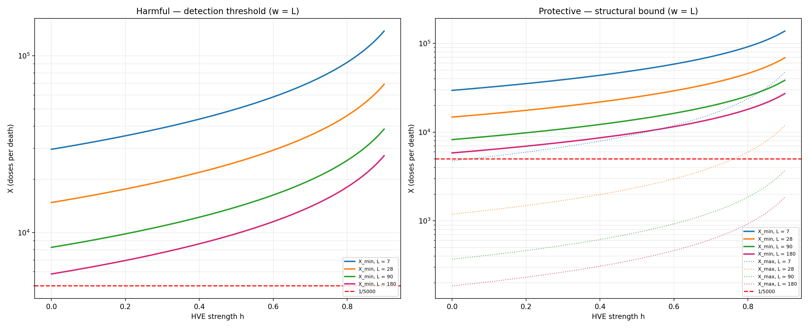
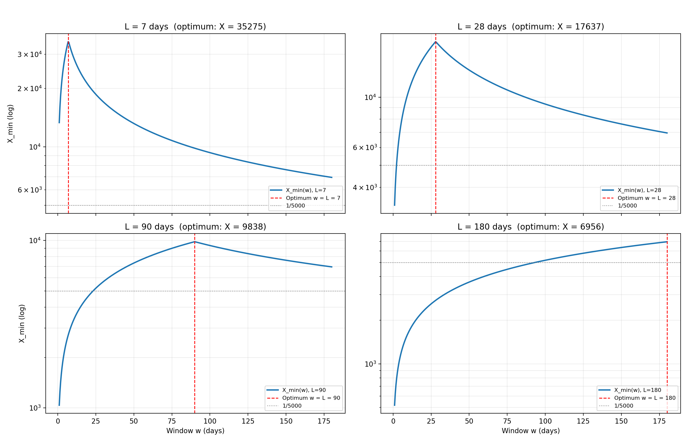

# Detectability Atlas

**Before you analyze observational data for a small effect, ask two questions:**
**Could you even see it? And — if it's protective — is it structurally possible at all?**

This is a small, focused planning tool. It does not perform causal inference. It does not adjust for confounding. It answers **one question in two directions**, symmetrically:

> Given your sample size, baseline event rate, presumed confounding strength (`h`), observation window (`w`), and effect duration (`L`) — **what is the smallest harmful effect you could detect, and what is the smallest protective effect that is both detectable and structurally possible?**

If the answer is "no, not with these data", no amount of clever statistics will save the analysis. Better to know that before you start — for both directions.

---

## The figure that answers both questions

**Left panel — Harmful effects:** detection threshold `X_min(h, L)`. An effect of size `1/X` is detectable with 90% power if `X ≤ X_min`. The HVE **masks** harmful effects — a stronger HVE makes them *harder* to see.

**Right panel — Protective effects:** the same detection threshold `X_min`, **plus** a structural bound `X_max(h, L)`. A protective effect stronger than `X_max` is *impossible* — you cannot prevent more deaths than the baseline produces.

**Red dashed line:** the `1/5000` benchmark (one event per 5,000 doses).

> *Assumes the optimal observation window `w = L`. For `w ≠ L`, detection thresholds fall — see the next figure. `N_V`, `N_U`, `μ` are illustrative; calibrate to your data.*

**What the two panels show together:**

- `1/5000` harmful — **detectable in principle** (red line below `X_min`), but every plausible HVE masks it. Absence of evidence is not evidence of absence.
- `1/5000` protective — **detectable in principle**, but the observed effect is consistent with pure HVE. Presence of a protective signal is not evidence of a protective cause.

Both directions lead to the same conclusion: **the data alone cannot resolve the question** — but the reasons are different, and the tool makes both visible.

---

## Why `w = L` matters

`X_min` is maximized when the observation window `w` matches the effect duration `L`. In practice `L` is unknown, so real-world detectability lies **below** the `w = L` curve. This figure shows by how much.

**Behavior:**
- `w < L` — you see only part of the effect → `X_min` rises with `w`
- `w = L` — **maximum** (`X_min` is optimal)
- `w > L` — you only add background noise → `X_min` falls with `w`

The hero figure above is a **best case**, not a realistic estimate. The gap between the two is the price of not knowing the effect duration.

---

## What it computes — both directions, same weight

For an effect of size **`1/X`** (one additional or prevented event per `X` doses):

| Quantity | Meaning | Harmful | Protective |
|---|---|---|---|
| **`X_min(h, w, L)`** | Detection threshold — 90% power if `X ≤ X_min` | ✔ | ✔ |
| **`X_max(h, L)`** | Structural bound — impossible if `X < X_max` | — | ✔ |
| **E-value contour** | Robustness against *additional* unmeasured confounders | ✔ | ✔ |

**The asymmetry, made explicit:**

| Question | Harmful effect | Protective effect |
|---|---|---|
| **Can I detect it?** | Yes if `X ≤ X_min` | Yes if `X ≤ X_min` |
| **Is it structurally possible?** | No upper bound | **Yes** — `X ≥ X_max(h, L)` |
| **How does HVE bias it?** | **Masks** the effect (works *against* detection) | **Amplifies** the observed signal (works *for* detection, but not causally) |
| **Additional constraint** | None | Only a fraction of deaths is preventable (`p_C` for ACM) |

**For the same `N` and `h`:** harmful effects are **harder to detect** (HVE masks them); protective effects are **easier to "detect"** — but the detected signal is **not causally interpretable** until the HVE is controlled. And even then, a protective effect stronger than `X_max` is **impossible** — a consistency check unavailable for harmful effects.

**Both directions are equally constrained — just by different things.**

---

## Worked example — the Czech FOI dataset

The tool was built while analyzing the Czech FOI dataset (~11 million individuals, 2021–2022) to answer a specific question:

> **Could the data distinguish a causal vaccine effect from a Healthy Vaccinee Effect (HVE) of plausible magnitude?**

The answer, symmetrically:

**Harmful direction:**
- A causal harmful effect of `1/5000` on ACM would be *masked* by any HVE with `h ≥ 0.037`.
- The data cannot rule out a small harmful effect — because the HVE would hide it.
- **Absence of a harmful signal is not evidence of absence.**

**Protective direction:**
- A causal protective effect of `1/5000` on ACM is *detectable* (`X_min(0.5, 180) ≈ 9,866 > 5,000`).
- But the observed protective signal is **consistent with both** a causal effect and pure HVE (`h ≈ 0.3–0.7`).
- **Presence of a protective signal is not evidence of a protective cause.**

**The symmetric conclusion:**
For effects in the `1/5000` range and HVE strengths in the plausible range, **observational data alone cannot resolve the question** — in either direction. The tool quantifies why.

---

## What this tool does **not** do

- It does **not** estimate causal effects — neither harmful nor protective.
- It does **not** adjust for confounding. It *parameterizes* it (`h`), because confounding strength is what you don't know.
- It does **not** replace Target Trial Emulation, negative controls, instrumental variables, or randomization.
- It is **not** a novel statistical method. It uses textbook power analysis for Poisson rates, with an HVE-adjusted baseline and a structural upper bound added.

---

## Limitations

| Limitation | Effect |
|---|---|
| **Uniform effect distribution over `L`** | Real effects often wane. The uniform assumption is *conservative* for waning (formula understates detectability) and *anti-conservative* for delayed-onset effects. |
| **Normal approximation** | Accurate for expected counts ≳ 10. For very small windows (`E_V ≈ 1000`), empirical power is ~5% below the analytical 90%. The script prints `CHECK` in this case — expected, not a bug. |
| **`h` must be specified** | The HVE strength is exactly what you don't know. The tool shows you *how detectability depends on it* — it cannot tell you which `h` is correct. |
| **`X_max` valid only for `w ≤ L`** | For `w > L`, the structural bound becomes `1/(μ w (1-h))`. |
| **Illustrative parameters** | `N_V = 6e6`, `N_U = 4e6`, `μ = 3e-5` are placeholder values. Calibrate before drawing conclusions. |
| **No `p_C` correction for ACM** | For protective effects on all-cause mortality, only a fraction of deaths is preventable. The structural bound `X_max` above is for the full ACM; for a specific cause, multiply by `1/p_C`. |

---

## Who should use it

- Anyone planning an observational analysis with **rare events** and **likely unmeasured confounding** (vaccine safety, drug safety, policy evaluation) — **in either direction**.
- Anyone who want to check whether a claimed "no harmful effect" or "protective effect" is a real result or a power/confounding artefact.
- Anyone explaining why *"no statistically significant effect"* ≠ *"no effect"* — and why the protective side has an additional structural ceiling.

---

## Repo structure
